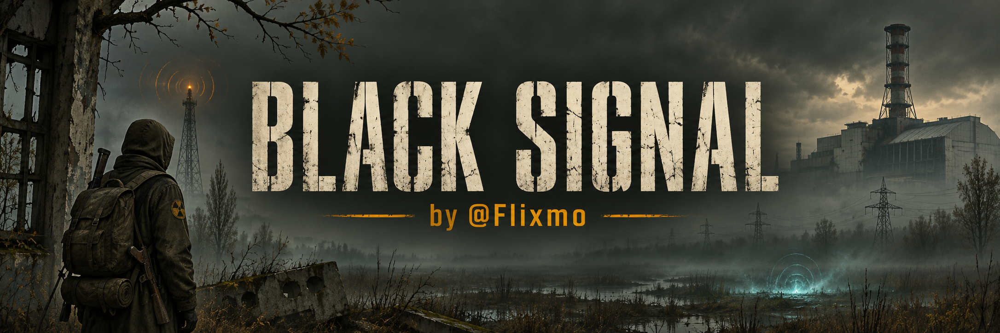

# BLACK SIGNAL — by @Flixmo

28 модов для **S.T.A.L.K.E.R. G.A.M.M.A.** Скачайте весь пак с выбором компонентов или любой мод отдельно.

**[Скачать весь пак 0.1.0](https://github.com/vobelo571/black-signal/releases/download/v0.1.0/BLACK-SIGNAL-0.1.0-MO2.zip)** · [Установка и зависимости](INSTALL.md) 

| Мод | Что делает | Скачать |
|---|---|---|
| [Повторный обыск](modules/repeat-loot/README.md) | Небольшие дополнительные находки каждые 24 игровых часа на всей зоне. | [ZIP](https://github.com/vobelo571/black-signal/releases/download/v0.1.0/BLACK-SIGNAL-repeat-loot-0.2.0.zip) |
| [Пополнение торговцев из КПК](modules/pda-trader-restock/README.md) | Кнопка платного обновления ассортимента: за 25 000 RU. | [ZIP](https://github.com/vobelo571/black-signal/releases/download/v0.1.0/BLACK-SIGNAL-pda-trader-restock-1.0.0.zip) |
| [BHS Fixes](modules/bhs-fixes/README.md) | Фикс на BHS после перехода между локациями, после лечения у костра. | [ZIP](https://github.com/vobelo571/black-signal/releases/download/v0.1.0/BLACK-SIGNAL-bhs-fixes-1.0.0.zip) |
| [Удалить все сохранения](modules/delete-all-saves/README.md) | Кнопка массового удаления сохранений в меню загрузки. | [ZIP](https://github.com/vobelo571/black-signal/releases/download/v0.1.0/BLACK-SIGNAL-delete-all-saves-1.0.0.zip) |
| [Жила: торговец Арены](modules/arena-mutant-trader/README.md) | Уникальный NPC, обитает на Ростке, продает части мутантов | [ZIP](https://github.com/vobelo571/black-signal/releases/download/v0.1.0/BLACK-SIGNAL-arena-mutant-trader-1.5.5.zip) |
| [Сеть тайников](modules/stash-network/README.md) | Управление сетью хранилищ и распределением предметов. (через стандартный интерфейс GAMMA) | [ZIP](https://github.com/vobelo571/black-signal/releases/download/v0.1.0/BLACK-SIGNAL-stash-network-1.2.0.zip) |
| [Пресеты пояса](modules/belt-presets/README.md) | Три пресета артефактов пояса в инвентаре. | [ZIP](https://github.com/vobelo571/black-signal/releases/download/v0.1.0/BLACK-SIGNAL-belt-presets-1.0.0.zip) |
| [Без притягивания мутантов](modules/mutant-magnetism-fix/README.md) | Небольший фикс на магнит мутантов во время удара к вам. | [ZIP](https://github.com/vobelo571/black-signal/releases/download/v0.1.0/BLACK-SIGNAL-mutant-magnetism-fix-1.0.zip) |
| [Снаряжение Зоны](modules/zone-field-gear/README.md) | 32 фракционных костюма: восемь семейств, модели, руки, иконки и баланс. | [ZIP](https://github.com/vobelo571/black-signal/releases/download/v0.1.0/BLACK-SIGNAL-zone-field-gear-0.7.1.zip) |
| [Мягкие лучи и спокойная погода](modules/soft-rays-weather/README.md) | Мягкие лучи, сокращённые выборки шейдеров, ослабление дождя и отключение Pulse. | [ZIP](https://github.com/vobelo571/black-signal/releases/download/v0.1.0/BLACK-SIGNAL-soft-rays-weather-1.0.zip) |
| [Калибр: снабженец Янтаря](modules/yantar-hunter/README.md) | Торговец противомутантными боеприпасами с пятью ступенями репутации фракции Ученые. | [ZIP](https://github.com/vobelo571/black-signal/releases/download/v0.1.0/BLACK-SIGNAL-yantar-hunter-1.0.0.zip) |
| [Фикс веса артефактов](modules/artefact-weight-fix/README.md) | Выравнивает вес артефактов. | [ZIP](https://github.com/vobelo571/black-signal/releases/download/v0.1.0/BLACK-SIGNAL-artefact-weight-fix-1.0.0.zip) |
| [Ориентир: проводник Янтаря](modules/yantar-guide/README.md) | Постоянный проводник с восемью платными маршрутами расположенный на Янтаре, фракции Ученые. | [ZIP](https://github.com/vobelo571/black-signal/releases/download/v0.1.0/BLACK-SIGNAL-yantar-guide-1.0.1.zip) |
| [Арсенал NPC](modules/npc-arsenal/README.md) | Оружие обычных NPC по рангу; повторная выдача потерянного оружия. Квестовые и уникальные персонажи сохраняют комплекты. | [ZIP](https://github.com/vobelo571/black-signal/releases/download/v0.1.0/BLACK-SIGNAL-npc-arsenal-1.3.0.zip) |
| [Колесо еды и медикаментов](modules/qaw-food-meds/README.md) | Автозаполнение колесо едой и медициной автоматически. | [ZIP](https://github.com/vobelo571/black-signal/releases/download/v0.1.0/BLACK-SIGNAL-qaw-food-meds-1.0.0.0.zip) |
| [Звания и научные должности](modules/career-ranks/README.md) | Карьерные приставки для Долга, Военных и Учёных. | [ZIP](https://github.com/vobelo571/black-signal/releases/download/v0.1.0/BLACK-SIGNAL-career-ranks-1.0.0.zip) |
| [Полезные эффекты навыков](modules/skill-perks/README.md) | Пассивные эффекты и множители опыта по уровням навыков. | [ZIP](https://github.com/vobelo571/black-signal/releases/download/v0.1.0/BLACK-SIGNAL-skill-perks-0.1.1.zip) |
| [Шаги NPC: конфигурация Oleh](modules/footsteps-config/README.md) | Улучшенные шаги от NPS. | [ZIP](https://github.com/vobelo571/black-signal/releases/download/v0.1.0/BLACK-SIGNAL-footsteps-config-1.0.0.zip) |
| [Taskboard: редакция FLX](modules/taskboard/README.md) | Группировка заданий, накопительные бонусы, метки и настраиваемая сдача. | [ZIP](https://github.com/vobelo571/black-signal/releases/download/v0.1.0/BLACK-SIGNAL-taskboard-2026.10.25.zip) |
| [Отдых у костра](modules/campfire-rest/README.md) | Посадка у костра для лечения. Rest in sit ;) | [ZIP](https://github.com/vobelo571/black-signal/releases/download/v0.1.0/BLACK-SIGNAL-campfire-rest-1.0.0.zip) |
| [RF-Частота+](modules/rf-frequency-plus/README.md) | Активные частоты заданий и районы поиска в подсказке ресивера. | [ZIP](https://github.com/vobelo571/black-signal/releases/download/v0.1.0/BLACK-SIGNAL-rf-frequency-plus-1.0.2.zip) |
| [Слышимые шаги врагов](modules/audible-footsteps/README.md) | Пространственный звук движущихся врагов. | [ZIP](https://github.com/vobelo571/black-signal/releases/download/v0.1.0/BLACK-SIGNAL-audible-footsteps-1.0.0.zip) |
| [Merramun: ноутбук-казино](modules/merramun-casino/README.md) | Слот Marramun перенесенный из игры Welcome to the Game III . | [ZIP](https://github.com/vobelo571/black-signal/releases/download/v0.1.0/BLACK-SIGNAL-merramun-casino-0.3.0-laptop.zip) |
| [Ycatan_: фотография](modules/nasoska-photo/README.md) | Отдельная замена фотографии и её иконки. spec. for @Ycatan_ \|Twitch\| | [ZIP](https://github.com/vobelo571/black-signal/releases/download/v0.1.0/BLACK-SIGNAL-nasoska-photo-1.0.zip) |
| [Личное радио КПК](modules/personal-radio/README.md) | Личный плейлист, сохранение трека после перехода(играет сначала), импортёр музыки. | [ZIP](https://github.com/vobelo571/black-signal/releases/download/v0.1.0/BLACK-SIGNAL-personal-radio-1.0.0.zip) |
| [Лазеры: исправление шейдеров](modules/laser-fix/README.md) | Лазеры: исправление шейдеров. | [ZIP](https://github.com/vobelo571/black-signal/releases/download/v0.1.0/BLACK-SIGNAL-laser-fix-1.0.0.zip) |
| [Ракурс и 1П76: исправление сеток](modules/reticle-fix/README.md) |Исправление прицелов: Ракурс и 1П76 | [ZIP](https://github.com/vobelo571/black-signal/releases/download/v0.1.0/BLACK-SIGNAL-reticle-fix-1.0.0.zip) |

**Как установить:** скачайте ZIP, установите через MO2 и включите ниже базовых модов. В общем паке отметьте нужные компоненты.
